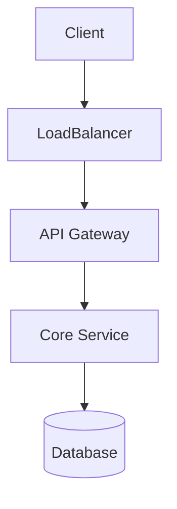
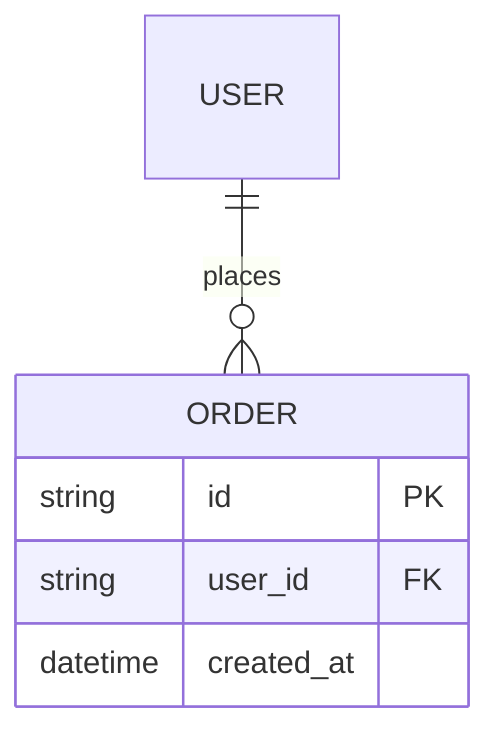

# Project Title (e.g., Design Distributed Lock Manager)

## 1. Problem Statement & Requirements
### 1.1 Functional Requirements
- Requirement 1
- Requirement 2

### 1.2 Non-Functional Requirements
- High availability (e.g., 99.99%)
- Low latency (e.g., P99 < 50ms)
- Consistency guarantees

## 2. Back-of-the-Envelope Estimations
- **Daily Active Users (DAU)**:
- **Read/Write Ratio**:
- **QPS (Average / Peak)**:
- **Storage / Bandwidth Sizing**:

## 3. High-Level Design (HLD)

## 4. Data Model & Database Design

## 5. API Contracts & Test Harnesses
- OpenAPI Spec: [contracts/openapi.yaml](./contracts/openapi.yaml)
- Bruno Collection: [bruno/](./bruno/)

## 6. Trade-offs, Bottlenecks & Failure Modes
- **Single Points of Failure (SPOF)**: Mitigation strategy...
- **CAP / PACELC Trade-off**: Choosing AP vs CP...
